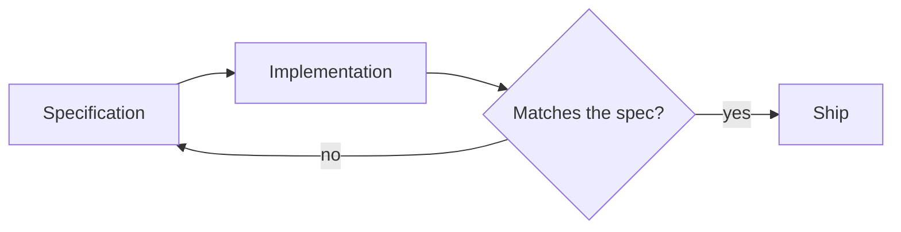

This file is the sample article. It is marked `draft: true`, so it shows up while you run `npm run dev` and is left out of every production build. Copy it when you start a new article, or delete it once you no longer need the reference.

## Text and headings

Start sections at level two (`##`). The article title is the only level-one heading on the page, and the build fails if the body contains another one. Level-two and level-three headings feed the table of contents.

Body text supports **strong emphasis**, *emphasis*, [links](https://www.11ty.dev/), and `inline code` for identifiers such as `IServiceCollection`.

### A third-level heading

Use these to split a long section. They appear indented in the table of contents.

## Lists

Unordered lists suit items with no inherent order:

- Reverse-engineer the behaviour before changing it.
- Put the specification in the repository, next to the code.
- Keep the pipeline fast enough that people run it.

Ordered lists suit steps:

1. Write the specification.
2. Let the assistant implement against it.
3. Review the result against the specification, not against the diff alone.

## Quotes

> A specification is the cheapest place to find out that two people meant different things by the same word.

## Tables

| Environment | Trigger            | Approval      |
| ----------- | ------------------ | ------------- |
| Development | Every merge        | None          |
| Staging     | Nightly            | None          |
| Production  | Release tag        | Two reviewers |

Wide tables scroll sideways inside their own box on small screens.

## Images

Put images in `assets/blog/<article-slug>/` and reference them with a root-relative path. An image on its own line becomes a figure, and the optional quoted title becomes its caption.


## Code

Fenced code blocks are highlighted at build time. Name the language after the opening fence.

```csharp
public sealed class TrailerMoveHandler(IMoveRepository moves, ILogger<TrailerMoveHandler> logger)
{
    public async Task<Result> HandleAsync(MoveTrailer command, CancellationToken ct)
    {
        var move = await moves.FindAsync(command.MoveId, ct);
        if (move is null)
        {
            logger.LogWarning("Move {MoveId} was not found", command.MoveId);
            return Result.NotFound();
        }

        move.AssignTo(command.YardSlot); // domain rule lives on the aggregate
        await moves.SaveAsync(move, ct);
        return Result.Ok();
    }
}
```

Template syntax from other tools is safe to show as it is, because articles are not run through a template engine:

```yaml
- name: Build with Eleventy
  run: npm run build
  env:
    SITE_URL: ${{ steps.pages.outputs.base_url }}
```

```bash
npm run dev      # write with live reload
npm run build    # production build into dist/
```

## Diagrams

A fenced block with the language `mermaid` is drawn as a diagram in the browser. Without JavaScript, readers see the diagram source as a code block.


